# Rhine Music · Direct3D Windows 原生版 0.1

基于 Rhine Music / RhineLabUI 的 Windows 原生重构工程，由 [GamesDing](https://github.com/gamesding) 完成本版本重构。前端使用 **C++20、Win32、Direct3D 11 / 12、Direct2D 和 DirectWrite**，保留原版的音乐档案馆、玻璃专辑架、动画、音乐库、音频处理与署名。

界面直接绘制到原生窗口。发行程序包含运行所需的本地音乐服务、解码器、Sony 音效组件和运行库，无需安装 Electron、浏览器、Node.js、Python 或 Sony 手柄 SDK。源码编译需要另外安装下文列出的开发工具。

**这是完整的私有源码发行工程。** 本项目自己的前端、着色器、后端、音频宿主、打包器、模型脚本与验证代码都在仓库中。PS4 / PS5 底层 SDK 调用组件按二进制形式提供；用户不需要获得 Sony 私有头文件，就能编译并使用手柄功能。厂商二进制、字体和非代码素材各自保留原许可，不随项目程序代码改授 MIT。

**发行版本为 0.1，上游基础版本仍为 V0.3.0。** 最终播放器、独立图形配置程序、使用说明、许可与 ZIP 包统一生成在仓库的 `Release/`。第一次运行或遇到显卡兼容问题时，先打开 `Release/RhineConfiguration.exe`，保存后再手动启动 `Release/RhineMusic.exe`。

## 维护与反馈

本衍生版本基于上游 **V0.3.0**，由 [GamesDing](https://github.com/gamesding) 维护 Windows 原生实现与功能扩展。项目仓库为 [gamesding/RhineMusic-D3D](https://github.com/gamesding/RhineMusic-D3D)，问题与建议请提交到本仓库的 [Issues](https://github.com/gamesding/RhineMusic-D3D/issues)。上游来源、版本差异与适用署名、许可见下文；本版本由其维护者独立提供支持。

## 目录

- [维护与反馈](#维护与反馈)
- [界面截图](#界面截图)
- [这次重构做了什么](#这次重构做了什么)
- [音乐库与搜索](#音乐库与搜索)
- [播放控制与循环](#播放控制与循环)
- [音频输出与 Sony 音效](#音频输出与-sony-音效)
- [CD 播放与光盘交互](#cd-播放与光盘交互)
- [图形接口、超分与反射](#图形接口超分与反射)
- [独立图形配置程序](#独立图形配置程序)
- [鼠标、键盘、触屏与手柄](#鼠标键盘触屏与手柄)
- [设置、界面与动画](#设置界面与动画)
- [编译完整程序](#编译完整程序)
- [工程结构与依赖](#工程结构与依赖)
- [验证方法与覆盖范围](#验证方法与覆盖范围)
- [数据目录与安全边界](#数据目录与安全边界)
- [常见问题](#常见问题)
- [版权与来源](#版权与来源)

## 界面截图

以下是从本源码副本构建的原生程序实际截取的画面，使用隔离示例库与合成测试音频。专辑名称、音质标签和封面用于说明界面，不包含作者的个人曲库、目录配置或 FTP 凭据。截图不是设计稿，具体配置和文件哈希见 [源码构建验证记录](docs/SOURCE-BUILD-VALIDATION.md)。

### 暖昼与深夜专辑架

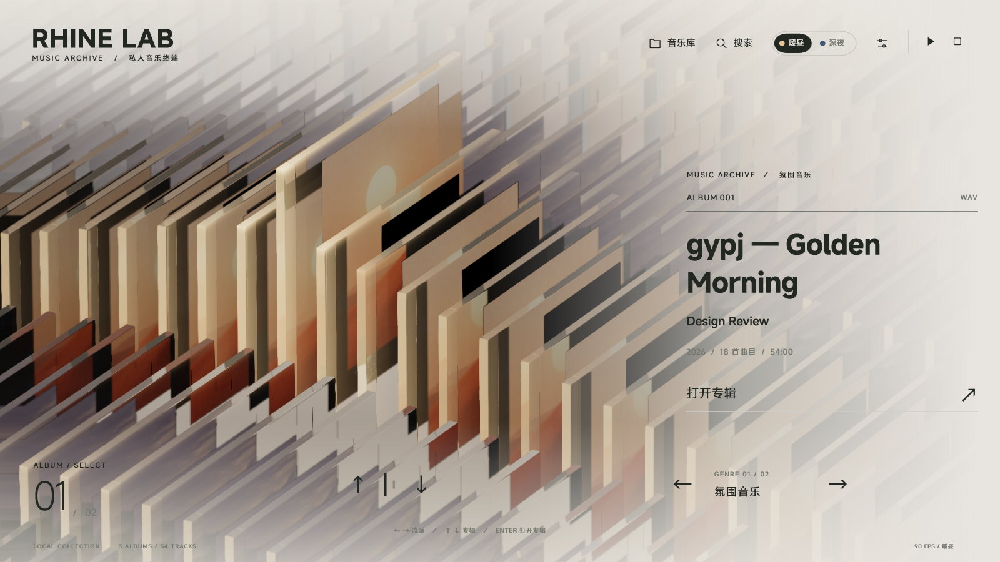

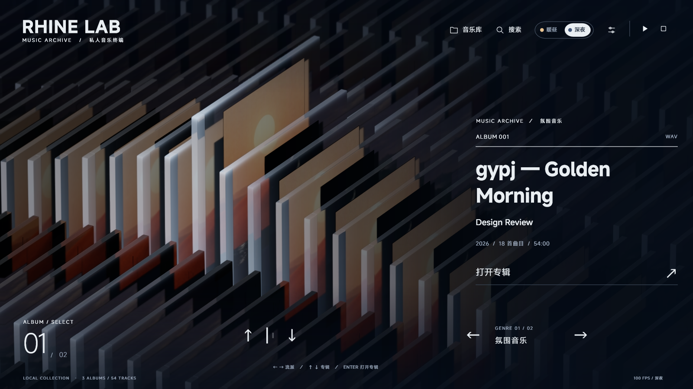

### 专辑详情、音质标识与播放条

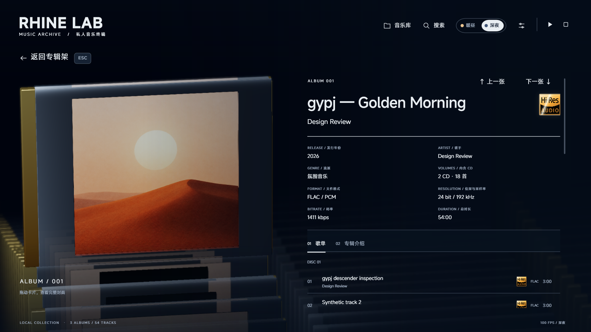

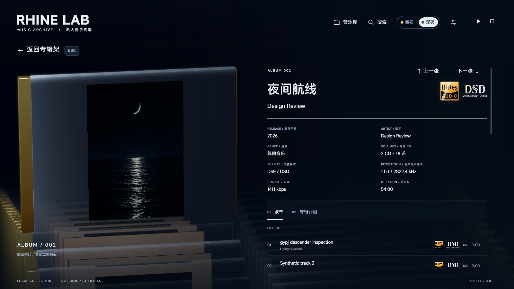

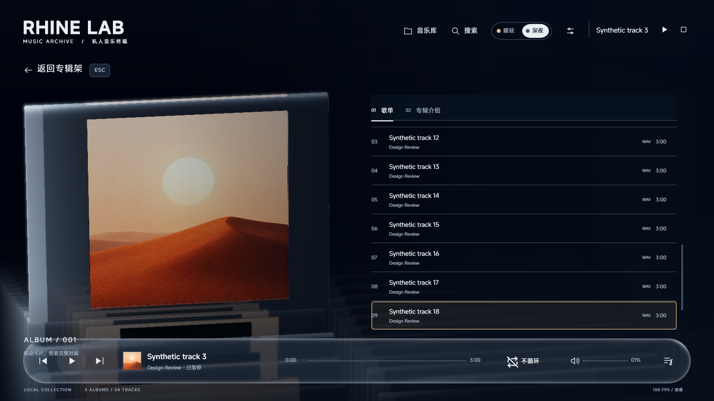

### 搜索、音乐库与设置

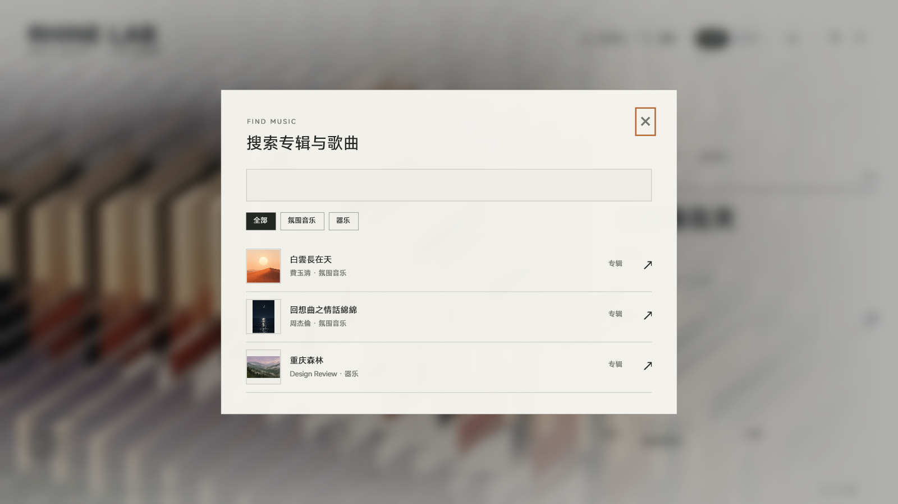


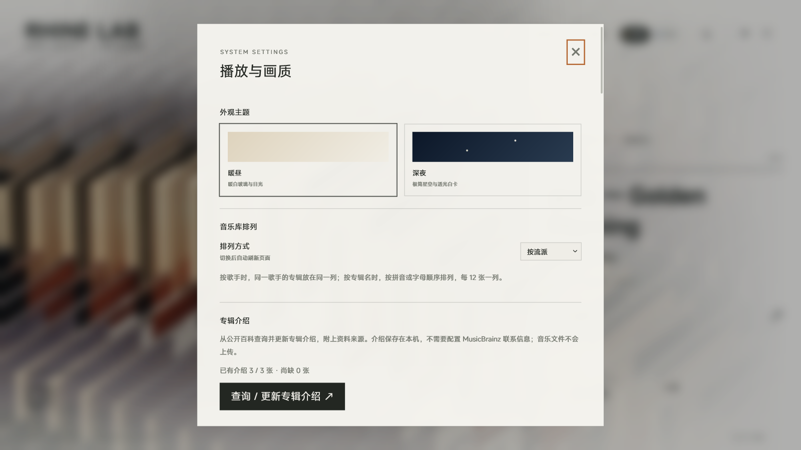

### CD 与手柄

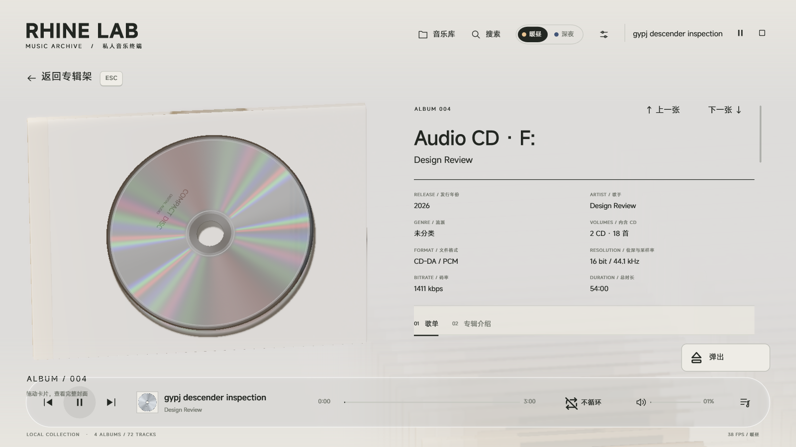

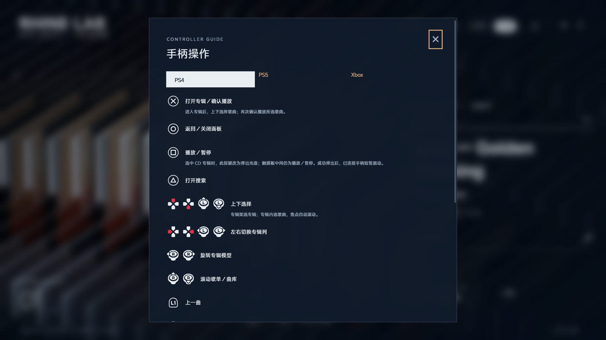

## 这次重构做了什么

| 部分 | 实现与变化 |
| --- | --- |
| 原生窗口 | 使用 Win32 窗口、Windows 消息和 DPI 感知；前端不再依赖 Electron、Chromium 或网页布局引擎。 |
| 三维渲染 | 原版模型与场景状态迁移到 D3D11 / D3D12；保留玻璃、封面、阴影、环境遮蔽、景深、透射、后处理与星空。 |
| 二维界面 | Direct2D / DirectWrite 绘制文字、矢量图标、列表、面板与动画；MiSans 和原图标随程序保留。 |
| 播放与服务 | 沿用上游音乐服务、播放器状态机、元数据读取、原生解码与 Sony 处理逻辑，避免用一套缩水的播放实现替换原有能力。 |
| 图形兼容 | 加入 DX11 路径、DX12 路径、NVIDIA DLSS、AMD FSR、SSR 与符合条件的 RTX 光谱反射。 |
| 输入设备 | 统一鼠标、键盘、触屏、XInput 与 Sony 手柄输入；恢复进入专辑后的选歌焦点与确认播放逻辑。 |
| 播放细节 | 增加单曲循环、专辑循环；修复播放 / 暂停图标状态，并加入线性转换动画。 |
| CD | 增加直接读取和播放音频 CD、插盘反馈、自动选中、新的光盘外观、弹出与手柄震动。 |
| 搜索与编辑 | 支持简繁互搜、拼音与首字母；统一焦点效果、真实闪烁光标与密码遮罩。 |
| 稳定性 | 修复面板短暂上跳、滚动条无法拖动、列表边界继续滚动产生抖动、提示框文字被裁切等问题。 |
| 独立图形配置 | 软件绘制的配置窗口，无需先启动播放器；检测显卡、DX11 / DX12、光追、内存与 CPU，提供自动推荐、自定义及软件兼容渲染。 |
| 程序打包 | 在 `Release/` 生成单文件播放器、独立配置程序与 0.1 ZIP 包；嵌入资源、运行库、许可与文件校验清单。 |
| 源码发行 | 提供离线构建依赖、自动探测工具路径的构建脚本、二进制手柄接口和实际构建验证记录。 |

项目仍保留原版资源、上游源码快照与来源信息。独立的“音乐专辑 360° 模型查看器”因先前设备恢复 / 卡死问题，按使用者要求移除了入口；主页与专辑详情中的三维模型、玻璃、封面和交互继续保留。上游档案资料与原作资源也仍在工程中。

## 音乐库与搜索

### 本地曲库

- 在顶部“音乐库”中设置一个或多个音乐目录，扫描并建立索引。
- 根目录直属的音频文件按独立单曲专辑处理；子目录中包含的音频按文件夹归并为专辑。
- 保留标题、艺术家、专辑、年份、流派、曲号、盘号、时长、采样率、位深与格式等元数据。
- 支持内嵌封面与文件夹封面，复用解码后的图片和图集，避免换专辑时先显示占位再重新加载。
- 保留排序、流派分类、流派规则编辑、重新扫描、专辑介绍与元数据相关设置。
- 扫描和搜索不改写音乐文件及其标签。没有封面的专辑使用程序内的占位外观。
- 专辑架的循环位置用于场景连续显示；底部专辑 / 曲目统计显示真实曲库数量。

当前扫描器识别：`FLAC`、`WAV`、`M4A`、`MP4`、`ALAC`、`DSF`、`DFF`、`MP3`、`AAC`、`AIFF / AIF`、`OGG`、`OPUS`。容器的实际播放能力取决于内含编码与随包解码器，文件扩展名本身不能证明编码受支持。

### 简繁、拼音与定位

- 简体和繁体使用离线 OpenCC 字符、词组及地区字形表归一化，输入“周杰伦”也可以匹配“周杰倫”。
- 使用离线 pinyin-pro 数据生成拼音搜索键，支持完整拼音和拼音首字母，保留中文与英文混合查询。
- 音调、拼音分隔与大小写按搜索规则归一化；拼音匹配依赖字典，专有名称的多音字读法可能与个人习惯不同。
- 搜索覆盖专辑、歌曲、艺术家与流派，并支持分类筛选。
- 结果保留具体专辑 ID 和歌曲 ID，打开后定位到对应歌曲。
- 点击顶部正在播放的歌曲标题也可以定位原曲；当前已打开该专辑时直接定位，跨专辑时按完整场景转换处理。
- 定位后平滑滚动并高亮；手动滚动、换专辑或返回可取消定位提示。
- 搜索用的归一化与拼音键存在内存中，不覆盖原始标签。

### FTP 与在线相关能力

原版 FTP / FTPS 曲库设置、连接测试、保存并扫描、重新扫描与移除连接保留。主机、端口、协议、用户、密码和远程目录均可编辑；密码框显示 `*`，保留已有密码时可以留空。服务器文件保持只读，FTPS 验证服务器证书；播放时缓存所选歌曲，缓存上限 4 GB，可停止播放后清理歌曲缓存。

保留 MusicBrainz 的资料补全与联系信息配置、扫描后自动补全、手动分类优先规则和缓存。公开百科专辑介绍支持批量查询 / 更新、显示进度和缺少介绍的专辑，不确定的匹配不会覆盖已有介绍，也不会上传音乐文件。

在设置末尾的“foobar2000 / Beefweb 播放列表”中，可配置已有 Beefweb 服务地址并查看 / 导入播放列表。对应的 Internet Archive、Subsonic 和在线播放代理逻辑、取消下载、下一曲衔接及认证配置继续保留于服务源码；网络来源各自需要有效的服务端与网络连接。

原版在线服务和对应配置代码仍在，当前顶部空的“在线”入口按要求隐藏。FTP 配置可从设置使用；隐藏入口不代表已经提供一个有内容的公共在线音乐目录。需要连接远程服务的操作仍需要网络和有效的服务端配置。

## 播放控制与循环

正在播放时，底部玻璃播放条显示专辑封面、歌名、艺术家、上一曲、播放 / 暂停、下一曲、进度、时间、音量、循环与播放列表。顶部也保留播放控制与歌曲定位入口。

- 播放 / 暂停图标绑定实际播放器状态；进入暂停后显示播放三角，播放后显示暂停双竖线。
- 图标转换使用线性插值，支持中途反向切换；启用减少动态效果时直接切到目标图形。
- 支持拖动进度定位、音量调节、播放列表、停止和连续播放。
- 歌曲淡入淡出默认开启并保存。换歌先淡出当前曲目再播放下一首。
- 选歌焦点和播放状态分别管理，移动选择不会自行切换正在播放的曲目。

循环按钮带 SVG 图标与中文文字，点击依次切换：

| 模式 | 自然播放结束时 | 手动下一曲 |
| --- | --- | --- |
| 不循环 | 按队列继续；到末尾停止 | 切换到下一曲 |
| 单曲循环 | 当前曲目从头重新播放 | 仍可主动切换曲目 |
| 专辑循环 | 在所属专辑中顺序播放，最后一曲后返回首曲 | 在专辑中继续切换 |

选择会持久化。停止播放不会因为循环开启而再次启动。循环和播放列表按钮共用稳定布局，不再使上方列表短暂跳动。

## 音频输出与 Sony 音效

### 输出方式

| 输出 | 使用方式与条件 |
| --- | --- |
| 系统输出 · WASAPI | 使用系统的共享输出路径，便于与其他程序同时播放。 |
| WASAPI 独占 | 独占所选设备，按音源和处理结果的格式协商；选择保存稳定设备标识。 |
| ASIO | 使用本机安装的 ASIO 驱动；可选择驱动、起始输出通道和 DSD 模式。 |

WASAPI 独占不会在初始化失败时悄悄改用共享输出或任意重采样。设备不支持所需采样率 / 声道 / 格式时会说明原因，可以在设置里选择 DAC 对应端点或改用其他输出。

ASIO 驱动由声卡 / DAC 厂商提供，不属于本仓库。编译或运行程序不需要连接 DAC；实际 ASIO 和原生 DSD 播放需要相应设备、驱动以及有效的输出通道。

### PCM 与 DSD

- 保留原生解码、PCM 输出及音源格式信息。
- 支持 DSD 转 PCM、原生 DSD 与 DoP 三种处理 / 输出路线。
- 原生 DSD 和 DoP 需要驱动及硬件支持；能识别 DSF / DFF 不意味着任意声卡都能直出 DSD。
- 原生 DSD / DoP 直出锁定数字音量并旁路 PCM 音效及淡入淡出；应使用 DAC 调节实际音量。DSD 转 PCM 可使用普通音量和适用音效。
- 不受支持的 DSD / DoP 组合会给出错误并释放或恢复输出状态。
- 原版 Hi-Res 与 DSD SVG 标识、金色扫光和呼吸动画保留，不用普通文本代替技术标志。

### Sony 处理

保留原版 Sony 运行组件和固定 SHA-256，提供 DSEE AI、DC 相位线性化、黑胶相关处理，以及对应参数、状态、缓存和技术图标。原文件不重新编译、不修改字节、不改授 MIT；项目自己的桥接与处理调度源码继续提供。

- DSEE AI 的原版输入工作范围为 44.1 / 48 kHz。
- DC 相位与黑胶原版处理覆盖 44.1、48、176.4、192 kHz。
- 超出组件工作范围时保留原采样率，旁路不适用的处理，并在界面说明。
- DSD 转 PCM 路线可进入适用的 PCM 音效处理；原生 DSD / DoP 直出旁路 PCM 音效。
- 更改音效设置会保留播放位置；处理进程、取消操作和缓存沿用上游机制。
- DSEE、S-MASTER / DC、黑胶标志继续使用原版资源，播放 / 暂停与减少动态效果会影响相应动效。

有关处理来源与上游研究，参阅 [Sony Walkman 说明](upstream/docs/SONY-WALKMAN.md)、[DMP-Z1 研究](upstream/docs/DMP-Z1-RESEARCH.md) 和随包组件许可。产品名称及技术名称不表示本爱好者工程获得品牌官方支持。

### 氛围 BGM 与界面音资源

原版 BGM、操作声音、音量偏好及相关源码全部保留。当前桌面版沿用上游 Windows 原生输出模式的规则：禁用网页 BGM / 界面音与原生歌曲的混播，对应控件显示禁用状态。不能把保留资源和配置描述为已经启用的原生背景混音功能；这项行为与现有原生版本一致。

## CD 播放与光盘交互

使用电脑可见的物理光驱或兼容的虚拟光驱直接播放 **CD-DA 音频 CD**。数据光盘中的音频文件应作为普通文件曲库处理；DVD / Blu-ray 影视导航不是此功能范围。

1. 插入音频 CD，程序接收 Windows 介质变化事件。
2. 顶部中间出现线性旋转的 SVG 光盘读取提示。
3. 读取光驱与 TOC 后，将音轨加入曲库并自动选中刚识别的 CD，避免用户以为插盘没有反应。
4. 自动选中不会自动播放；进入专辑后可选择音轨并播放。
5. 选中 CD 时右下角显示带图标和文字的“弹出”，点击即可弹出所选驱动器。

- 音轨保留 CD-DA / PCM、16 bit / 44.1 kHz、曲号和时长信息。
- 不要求先抓轨，不把整张光盘复制进工程或源码仓库。
- CD 以圆形光盘呈现，带中心孔、金属表面和光谱色彩；三维大光盘播放时高速匀速旋转，暂停或未播放时保持角度。
- 底部播放条的小封面保持静止；不会把方形缩略图一起旋转。
- 启用 SSR / RTX 后，光盘背面的光学效果与反射相结合；RTX 使用更精细的光线与光谱处理。
- CD 不再沿普通专辑阵列复制出一长排玻璃盒；**每个有效光驱 / 介质对应一个独立玻璃片与光盘**，多个已识别驱动器分别显示。
- 读取转圈只表示介质读取，和播放时三维光盘的旋转分别管理。
- 弹出正在播放的所选 CD 前会停止其播放并释放光驱，其他文件专辑不会因此停止。
- PS4 / PS5 的 □、Xbox 的 X 在当前 CD 上下文中执行弹出。成功后已连接手柄短震约 160 ms；失败时不会显示成功或触发成功震动。
- 提示框依据文字测量自动布局，兼容昼夜、长消息、小窗口和换行。
- 曲目格式后面的多余小箭头已移除。

## 图形接口、超分与反射

### 图形兼容路线

| 显卡 / 接口 | 超分路线 | 反射路线 |
| --- | --- | --- |
| DX12 + 满足 NGX 条件的 NVIDIA GPU | DLSS Super Resolution；也可手选 FSR 或原生 | SSR / 关闭；满足条件的 RTX 可启用硬件光谱反射 |
| DX12 + AMD、Intel 或其他兼容 GPU | AMD FidelityFX 选择硬件支持的 FSR 提供器；也可原生 | SSR / 关闭 |
| DX11，Feature Level 11_0 或以上 | 官方 FSR 1 空间超分 / 原生 | SSR / 关闭 |

默认尝试 DX12，创建失败时可回退 DX11；设置里也可以固定接口。当前 temporal FSR 路线使用 DX12，DX11 路线明确标识为 FSR 1。界面文字、输入框和图标在最终窗口分辨率绘制，不随三维场景一起降分辨率。

### 固定版本

本工程依赖以开发时实际获取的版本固定，避免下一次编译自动下载不同版本导致行为改变：

| 组件 | 随包版本 / 路径 |
| --- | --- |
| NVIDIA DLSS SR | SDK / 运行组件 310.9.1 |
| AMD FidelityFX SDK | 2.3.0 |
| FSR 提供器 | SDK 带 FSR 4.1.1；不满足该路线的硬件可使用兼容 FSR 3.1.5 |
| DX11 超分 | 官方 FSR 1 |
| DirectX Shader Compiler | 1.9.2609 |
| 抗锯齿 | SMAA 1x 与对应原版质量设置 |

来源、版本和哈希在 [sdk-sources.json](vendor/sdk-sources.json)。界面显示实际使用的接口、提供器和回退原因；包含 FSR 4 的 SDK 不代表所有 GPU 都运行 FSR 4，也不表示本工程提供 DLSS 帧生成。

### 玻璃、SSR 与彩虹光谱

- 保留原版暖昼 / 深夜薄玻璃壳体、磨砂、透射、边框、封面受光和场景构图。
- SSR 使用屏幕中可见的场景信息近似反射，兼容 DX11 / DX12；屏幕外物体无法由 SSR 完整反射。
- RTX 路线要求本项目允许的 NVIDIA RTX 设备与 DXR 1.1 及以上能力，追踪实际玻璃几何中的光线、反射与光谱分量。
- 玻璃彩虹表现来自多波长折射、反射、全反射和光子落点累计；CD 金属面还包含光栅相关的彩虹效果，两种材料分别计算。
- 光追颜色受镜头、光照、材料厚度和遮挡影响，不会在每个位置都出现同样的长彩虹。
- 采样质量有上限，结合时序处理与空间滤波控制噪声；切换场景时重置不适用的历史，保留界面响应。
- 非 RTX 或缺少所需 DXR 能力时使用 SSR 或关闭反射。画面不会用一个“光追已开启”的标签冒充有效硬件光追。

质量设置保留渲染比例、像素倍率、阴影、环境遮蔽、景深、透射、各向异性和抗锯齿等选项，并增加接口、超分、反射与 RTX 质量相关设置。效果是否更快取决于显卡、分辨率与开启的效果，应以设备上的实际表现为准。

## 独立图形配置程序

### 先配置，再启动播放器

1. 双击 `Release/RhineConfiguration.exe`。配置窗口自身使用 WinForms / GDI+ 软件绘制，不需要先创建播放器的三维场景，也不依赖 DX12 能否运行。
2. 等待检测完成，检查显卡名称与 DX11、DX12、光追能力提示。程序实际创建测试设备，并验证 DX12 与 Direct2D 所需的 D3D11On12 互操作；不只按显卡型号猜测。
3. 选择“自动推荐”或“自定义”，按自己的需要选择超分。
4. 点击“确认并保存”。弹出“设置成功”提示后，点击“确定”，配置程序关闭。
5. 手动双击 `Release/RhineMusic.exe`。播放器在首次创建图形设备前读取这些设置，低配置用户不必先承受默认 DX12 / 高画质再进入设置修改。

配置程序不会自动启动播放器。取消或关闭窗口不会写入设置。播放器正在运行时，配置程序会提示先关闭播放器，防止两个程序同时覆盖配置。

### 自动推荐如何判断

检测结果包含每张显卡的独立标识、显存、DX11 / DX12 互操作、DXR 能力和对应光谱效果条件，也包含内存、逻辑处理器数量与是否使用电池供电。多显卡环境自动挑选可用的较强设备；自定义模式可指定另一张显卡。两张同名显卡仍按不同设备标识区分。

| 检测条件 | 推荐方向 |
| --- | --- |
| 不具备可用硬件 DX11，且系统 WARP 可用 | DX11 软件兼容渲染，降低三维分辨率、关闭反射 / 阴影 / 环境遮蔽 / 景深 |
| 显存不足 2 GB、内存不足 6 GB、少于 4 个逻辑处理器，或电池供电 | DX11、性能档、关闭反射；硬件路径默认兼容 FSR，减少透射与后处理负担 |
| 其他可用硬件 | 已验证的 DX12 或 DX11、SSR、适度分辨率与原版质量参数 |
| 显存至少 6 GB、内存至少 8 GB，且满足本项目 RTX 光谱条件 | DX12、平衡光追质量；支持时默认 DLSS |

自动推荐使用保守的能力与资源规则，不运行长时间性能基准，也不保证所有机器上都是最高帧率。推荐结果会在窗口中明确显示，用户可以随后切到自定义微调。

自动模式仍允许选择“原生分辨率”或超分，以及超分的质量 / 平衡 / 性能档。非 NVIDIA 显卡只有 FSR 与原生选项；NVIDIA GTX 等不支持 DLSS 的设备同样不显示 DLSS。具备 DLSS 条件的 NVIDIA RTX 可选择 DLSS、FSR 或原生。DX11 使用随包的 FSR 1，DX12 由随包 FidelityFX 提供实际可用的 FSR 路线，驱动不满足某条路线时由播放器报告回退。

### 自定义参数与兼容恢复

| 参数 | 可选内容与约束 |
| --- | --- |
| 渲染设备 | 已检测显卡；系统 WARP 可用时另提供“Windows 软件渲染” |
| 图形接口 | DX11；通过实际 DX12 / D3D11On12 检测时可选 DX12 |
| 超分与质量 | 原生、FSR、符合条件的 DLSS；质量 / 平衡 / 性能 / 原生抗锯齿 |
| 反射 | 关闭、SSR；满足 NVIDIA RTX / DXR 1.1 / 着色器条件的 DX12 设备才显示 RTX 光谱光追 |
| 反射质量 | 性能、平衡、质量 |
| 基础画质 | 性能、原始、高、极高；继续保留播放器原有参数 |
| 精细参数 | 渲染比例、像素倍率、阴影、环境遮蔽采样与分辨率、景深、透射分辨率、各向异性和 SMAA |

更换显卡或改为 DX11 时，窗口会同步移除不支持的选项，并调整无效组合。软件渲染固定使用 DX11 / 原生 / 关闭反射；它用于恢复显示与修改设置，复杂三维场景在 CPU 上仍可能较慢。若老机器白屏，建议先选择 DX11、性能档和关闭反射，必要时再使用软件兼容渲染；本次没有在真实老显卡上实测所有组合。

设置保存到播放器原有的 `%APPDATA%\Rhine Music\preferences.json`；开发隔离环境继续支持 `RHINE_APP_HOME`。仅更新图形相关字段，保留音乐目录、音频输出、音效、主题、音量与循环状态。保存采用写临时文件后原子替换；配置文件损坏时提示修复，不覆盖原文件。播放器遇到无法解析的启动图形设置时使用默认值。

0.1 配置窗口的圆角白边修复已包含在 `Release/RhineMusic-D3D-v0.1-Windows-x64.zip` 中；预编译包和自行编译使用同一标准文件名，包含修复后的独立配置 EXE 和完整播放器。

### 配置程序截图

下面是配置程序实际绘制的窗口，使用自动化测试中的合成显卡数据展示选项规则；合成数据不代表已在这些品牌的全部硬件上实测。实际电脑的两张 RTX A4500、DX11 / DX12、DLSS、光追与 WARP 路径另有渲染验证记录。

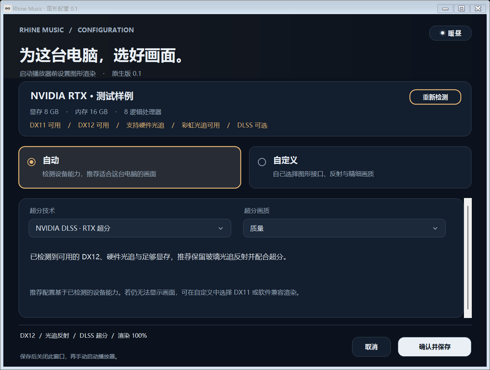

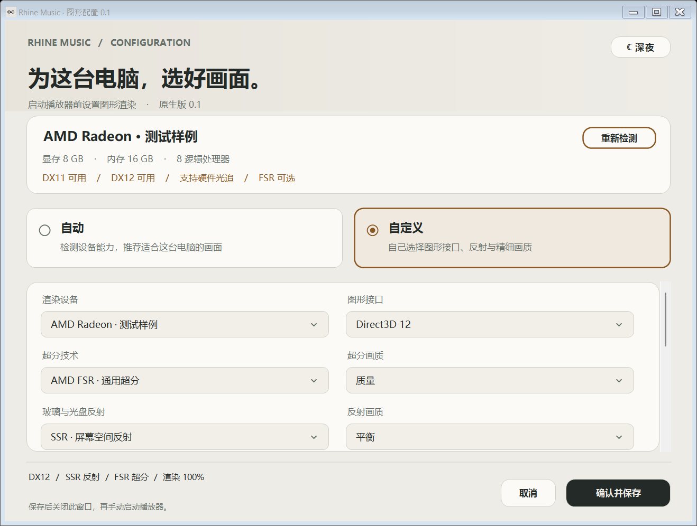

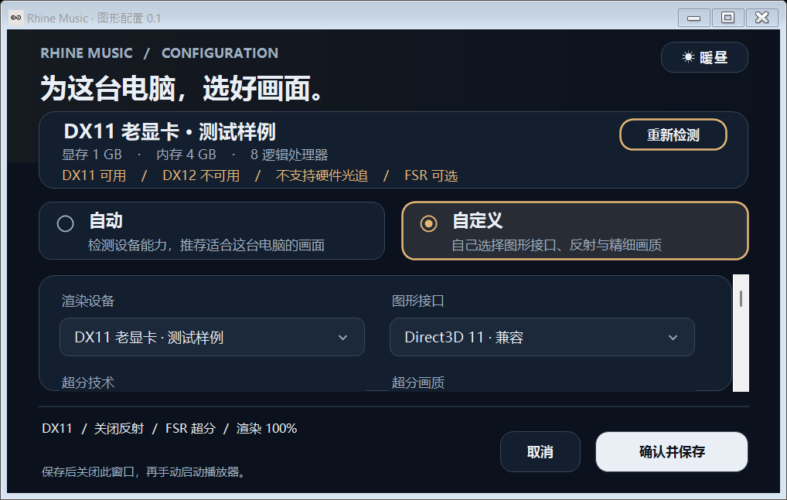

## 鼠标、键盘、触屏与手柄

### 鼠标与触屏

- 点击或拖动卡片、选择流派和专辑、打开详情、选择并播放歌曲。
- 滚轮滚动详情与设置；真实滚动条支持拖动滑块及点击轨道。
- 上下边界钳制实际滚动目标，继续滚动不会来回抖动或把面板抬起。
- 进度条与音量支持指针拖动。
- Windows Pointer 单指操作支持点击、拖动和列表滚动；双指输入沿原生触摸路由处理缩放 / 移动。
- 输入框使用 Windows 编辑控件承接中文输入法，合成到原生界面；点击后有焦点边框和标准闪烁光标。

### 键盘

| 按键 | 作用 |
| --- | --- |
| ← / → | 专辑架中切换流派 / 列 |
| ↑ / ↓ | 选择专辑；详情曲目导航按当前焦点处理 |
| Enter | 确认，打开专辑或执行当前控件 |
| Esc | 关闭当前菜单 / 面板或返回专辑架 |
| Space | 播放 / 暂停；编辑文本时保留文本输入行为 |
| Tab / Shift + Tab | 在可交互控件间移动焦点 |
| Ctrl + F | 搜索 |
| Ctrl + S | 设置 |
| Ctrl + L | 音乐库 |
| F11 | 全屏 / 窗口 |
| 键盘媒体键 | 播放暂停、上一曲、下一曲、停止 |

### Xbox、PS4 与 PS5

Xbox 使用 XInput；DualShock 4 / DualSense 使用随包二进制控制器桥接。型号识别会切换对应的 SVG 提示；最后使用的手柄和当前上下文决定提示内容。鼠标 / 键盘操作可恢复 ESC 提示。

| 操作 | Xbox | PS4 / PS5 |
| --- | --- | --- |
| 导航 | 方向键 / 左摇杆 | 方向键 / 左摇杆 |
| 确认、打开专辑、选歌后播放 | A | × |
| 返回 | B | ○ |
| 常规播放 / 暂停 | X | □ |
| 当前 CD 的弹出 | X | □ |
| 上一曲 / 下一曲 | LB / RB | L1 / R1 |
| 设置 | Menu / Start | Options |
| 搜索 | Y | △ |
| 焦点区域切换 | 右摇杆按下 | R3 |
| 旋转 / 滚动 | 右摇杆 | 右摇杆 / 未按下时触摸板拖动 |
| 音乐库 | View / Back | 从界面入口进入 |

进入专辑后，焦点自动落在可播放曲目上；上下选择歌曲、A / × 确认播放，B / ○ 返回。长歌单随焦点滚动；切换设置后返回可以继续选歌，边界不会把选择意外切到另一张专辑。

**Sony 触摸板分区操作：**

| 区域 | 短按 | 长按 |
| --- | --- | --- |
| 左侧三分之一 | 松开后上一曲 | 按住约 500 ms 后连续快退 |
| 中间三分之一 | 按下切换播放 / 暂停 | 不触发左右快进快退 |
| 右侧三分之一 | 松开后下一曲 | 按住约 500 ms 后连续快进 |

长按定位约 10 倍速，保留原本的暂停 / 播放状态；松开后不再额外切歌。按下位置在此次点击期间固定，失焦或断开连接会取消未完成操作，未按下时的拖动仍保留原功能。

59 个手柄 SVG 来自 Kenney Input Prompts 1.5，保留原始文件与 CC0 许可，运行图标使用 `currentColor` 适配暖昼 / 深夜。循环、弹出和光盘读取图标来自 Tabler Icons，保留 MIT 许可与固定版本信息。

### Sony 二进制边界

详情见 [PAD-BINARY-BOUNDARY.md](docs/PAD-BINARY-BOUNDARY.md)。

- 分发 `runtime/drivers/rhine-pad-bridge.dll`，封装 PS4 / PS5 的底层 SDK 调用。
- 提供项目自己的 [pad-bridge-api.h](native/pad-bridge-api.h)；不包含 Sony SDK 头文件、SDK 静态库、示例或底层实现源码。
- 导航、按键映射、触摸板操作、焦点处理与震动时长等项目逻辑继续提供源码。
- 通过 DLL 动态加载调用，不需要编译用户安装 Sony SDK 或访问开发者机器路径。
- DLL 随最终 EXE 的运行包分发，记录固定哈希；缺失 / ABI 不匹配明确报错。

## 设置、界面与动画

- 暖昼和深夜沿用原版配色与约 650 ms 过渡，主题选中底板平滑移动。
- 启动保留约 5.2 秒三维进场；跳过或减少动态效果可以直接进入选择界面。
- 标题和辅助信息保留 460 ms 字轮节奏，多行标题、新增行和英文下伸笔画处理分别保留。
- 普通专辑阵列每列使用 48 个循环显示位置；详情保持原版玻璃盒尺寸与斜视构图。
- 详情内上一张 / 下一张沿详情队列切换，文字退出、旧盒收回、新盒抽出与新信息进入协调执行。
- 返回按钮固定在左上标识下方，ESC 使用兼容两种主题的圆角键帽。
- 设置、音乐库、搜索保留原版面板段落、字体与排版；新增图形与手柄选项放在扩展设置中。
- 下拉菜单使用线性展开、收起与选中行移动；减少动态效果直接切换。
- 所有文本框共用焦点动画、Windows 闪烁光标、中文输入法路径和文本布局；所有密码编辑项保持星号遮罩。
- 播放玻璃附近的专辑 / 流派导航、CD 弹出和提示会避开占用区域，适配横屏、竖屏、小窗口与宽屏。
- 提示按实际文本测量自适应宽度、高度与换行，不使用只够固定几个字的框。
- Hi-Res、DSD 与 Sony 技术图标的线性动画保留，减少动态效果时仍显示图标。
- “开发与资源”第一行显示“此版本重构：GamesDing”，链接到作者 GitHub；上游作者、许可证与资源说明继续保留。
- “打开原版档案界面”保留原有档案资料、索引 / 收藏界面与模型资源；来源声明和相关非代码资产权利边界不变。
- Windows EXE、原生窗口与任务栏使用原版 `windows/app.ico`，保留原图标字节。

## 编译完整程序

### 开发环境

| 项目 | 要求 |
| --- | --- |
| 系统 | Windows 10 / 11 x64 |
| Visual Studio | VS 2022 或 VS 2022 Build Tools，安装“使用 C++ 的桌面开发”、MSVC v143 x64 / x86 工具 |
| Windows SDK | Windows 10 / 11 SDK，包含 x64 `fxc.exe`；本次验证使用 10.0.26100.0 |
| CMake | 3.24 或以上，加入 PATH |
| 外部 Python | 3.11 或以上，加入 PATH；本次验证使用 3.14 |
| 打包器与配置程序 | 系统 .NET Framework 4.8；使用 `Framework64\v4.0.30319\csc.exe` 编译 |
| 空间 | 建议至少 5 GB 空闲空间，供源代码、依赖解包、中间文件及 EXE 打包使用 |

运行程序所带的嵌入式 Python 用于原有音效桥接，不用它替代上述开发用 Python。Visual Studio Community、Professional 和 Build Tools 均可按组件要求准备；脚本不会硬编码 Professional 的安装目录。

所有必要图形头文件、链接库、运行库、离线拼音 / OpenCC 字典、原图标、Node 构建依赖和手柄二进制都随仓库提供。**正常构建不需要联网下载 SDK，不需要 Node / npm 安装，也不需要 Sony 手柄 SDK。** 远程音乐服务的日常使用与构建是否离线是两件事。

### 一条命令编译、打包

在仓库根目录打开 PowerShell：

```powershell
powershell -NoProfile -ExecutionPolicy Bypass -File .\build.ps1
```

默认执行完整 Release 构建，生成播放器、配置程序和 ZIP 包。编译并执行 CTest、音频软件检查、单文件隔离测试、配置程序与首次图形设备验证：

```powershell
powershell -NoProfile -ExecutionPolicy Bypass -File .\build.ps1 -Verify
```

若 `python` 命令不是需要的解释器，可指定路径；例如：

```powershell
.\build.ps1 -Python "C:\Python314\python.exe" -Jobs 4 -Verify
```

也可直接使用 Python：

```powershell
python .\tools\build.py --verify --jobs 4
```

### 构建脚本执行的内容

1. 验证固定运行依赖、离线压缩包和手柄二进制的 SHA-256；检查公开编译代码没有私有 SDK 声明。
2. 从 `vendor/build-dependencies.zip` 恢复 Node 构建依赖到 `build-tools/node_modules`，并逐文件验证。
3. 准备原版 UI / 技术 SVG、Kenney 手柄图标、Tabler 图标、BASSWASAPI 与离线搜索字典。
4. 按保留的上游音频宿主源码及本项目补丁生成、编译原生音频宿主。
5. 用随包 Node 和 esbuild 构建原播放器核心及 WASAPI 独占 / 循环扩展。
6. 执行 CMake x64 配置，使用已安装的 VS 2022 编译所有原生目标。
7. 从 Windows SDK 自动查找 FXC，用随包 DXC 编译三维、SSR、SMAA、FSR 与光追着色器。
8. 更新音频宿主文件哈希，打包程序文件、许可与运行清单。
9. 编译软件绘制的独立配置窗口，将硬件探测器与原图标嵌入 `RhineConfiguration.exe`。
10. 在 `Release/` 生成单文件播放器、配置程序、许可、使用说明、SHA-256 清单与 0.1 ZIP 包，审计包输入；使用 `-Verify` 时再运行验证。

### 产物

| 文件 / 目录 | 作用 |
| --- | --- |
| `Release/RhineMusic.exe` | 最终双击即用的单文件播放器，版本 0.1 |
| `Release/RhineConfiguration.exe` | 独立图形配置程序，可单独复制运行，内嵌硬件探测器 |
| `Release/RhineMusic-D3D-v0.1-Windows-x64.zip` | 0.1 完整发行压缩包，顶层目录 `RhineMusic-D3D-0.1/` |
| `Release/使用说明.txt` | 配置 → 确认 → 手动启动播放器的中文说明 |
| `Release/SHA256SUMS.txt` | 两个 EXE 与随包文档的 SHA-256 校验值 |
| `Release/LICENSE`、`NOTICE.md`、`THIRD-PARTY.txt` | 随发行包保留的上游及第三方许可说明 |
| `RhineMusicD3D.exe` | 原生播放器开发运行目标；需要仓库内的 backend / runtime / shaders |
| `RhineDeviceProbe.exe` | 手柄、光驱和硬件信息检查 |
| `RhineGraphicsProbe.exe` | 图形路径检查 |
| `build/Release/` | 编译的可执行目标与中间输出 |
| `build/package/native-runtime.zip` | 嵌入最终 EXE 的程序运行包 |
| `build/package/package-manifest.json` | 最终 EXE、运行包和内部文件的 SHA-256 清单 |

最终程序沿用原图标。单文件包含完整运行依赖，因此大小超过 GitHub 普通文件的 100 MiB 上限；它是构建产物，已在 `.gitignore` 排除，应通过合适的发行附件方式分发，而不是加入源代码提交。

### 用 Visual Studio 查看与调试

```powershell
.\build.ps1 -ConfigureOnly
cmake --open .\build
```

`ConfigureOnly` 会先准备完整依赖和生成文件，再创建解决方案。打开后使用 x64 配置。推荐先完成一次默认 Release 构建，取得根目录可运行的开发目标与当前音频哈希；前端常规调试不要求重新编译厂商手柄二进制。直接对未准备的全新仓库调用 `cmake --build` 不能代替依赖准备步骤。

## 工程结构与依赖

```text
RhineMusic-D3D/
├─ build.ps1                    完整构建入口
├─ CMakeLists.txt               原生目标与 CTest
├─ native/                      C++ 窗口、场景、图形、UI、输入、音频宿主与补丁
│  ├─ controller.cpp            公开控制器适配与项目交互
│  └─ pad-bridge-api.h          自有二进制手柄接口
├─ shaders/                     HLSL、光盘材质、SSR / 光追 / SMAA / FSR
├─ backend/                     本地服务、循环、搜索及播放器适配
├─ windows/                     单文件启动器、清单和原版 ICO
│  ├─ Configuration.cs          软件绘制配置窗口、主题、交互与成功提示
│  ├─ ConfigurationModel.cs     硬件推荐、参数约束与原子保存
│  └─ ConfigurationTests.cs     隔离的配置策略与实际控件检查
├─ runtime/                     运行资源、Node、Python、字典、解码器与厂商库
│  └─ drivers/                  仅二进制的 Sony 手柄桥接及哈希说明
├─ vendor/                      固定构建依赖、头文件、链接库及原始许可
│  ├─ build-dependencies.zip    离线 Node 构建依赖，包含包源码和许可
│  ├─ distribution-files.json  固定依赖完整性清单
│  └─ scepad/license/           原控制器库许可；没有 SDK 头文件或静态库
├─ upstream/                    保留的上游源码、素材、模型与构建脚本
├─ tools/                       准备、编译、打包、审计与验证脚本
├─ tests/                       原生状态、CD 场景与触摸板行为检查
├─ docs/                        技术文档、二进制边界、验证记录与截图
├─ Release/                     0.1 EXE、ZIP、许可与使用说明；构建生成，不提交
├─ source-manifest.json          上游来源及保留文件 SHA-256
├─ LICENSE                      保留的上游程序代码许可
└─ NOTICE.md                    保留的上游素材与来源说明
```

运行链路是：原生前端 → 本机回环音乐服务 → 原生音频宿主 / Sony 处理。Node 服务提供数据和播放器调度，C++ 渲染界面和三维场景；此版本不是“所有后端也都重写为 C++”。保留服务和 DSP 的独立进程，有利于复用已有格式与音效能力。

主要固定依赖包括 Node.js 26.7.0、嵌入式 Python 3.14、Unicorn 2.1.4、BASS 及相关插件、BASSWASAPI、DLSS、FidelityFX、DXC、SMAA、cgltf、nlohmann/json、OpenCC、pinyin-pro、MiSans、Kenney 和 Tabler。完整来源与许可见 [DEPENDENCIES.txt](docs/DEPENDENCIES.txt)、`runtime/licenses`、`runtime/public/licenses`、各组件自带许可与 [NOTICE.md](NOTICE.md)。

上游模型的 `.blend` 源文件和建模脚本保留在 `upstream/art`，运行模型在对应资源目录；正常编译使用随包模型，不要求安装 Blender。修改模型时需要按脚本及原许可重新生成。

## 验证方法与覆盖范围

本次源码整理的具体结果见 [SOURCE-BUILD-VALIDATION.md](docs/SOURCE-BUILD-VALIDATION.md)。历史技术文档记录原开发阶段的检查，不能替代这份源码副本的实际构建记录。

0.1 新增配置程序、启动设置、最终目录构建与发行验证见 [RELEASE-0.1.md](docs/RELEASE-0.1.md)。配置策略检查包含 NVIDIA RTX / GTX、AMD、Intel、低配置、软件渲染、多显卡、电池模式、选项联动、真实控件滚动、保存与确认退出；图形集成检查验证 DX11、DX12、超分、反射及 WARP 从首次设备创建就采用保存配置。

```powershell
# 独立配置程序、五条实际渲染路径与首次设备设置
python tools/validate-configuration.py
```

常用验证命令：

```powershell
# 状态连续性、CD 独立实例、设备接口与触摸板短按 / 长按
ctest --test-dir .\build -C Release --output-on-failure

# 播放器、循环、输出、Sony 调度等软件逻辑
python .\tools\validate-final-audio.py

# 单文件、独立运行目录、资源校验与损坏恢复
python .\tools\validate-standalone.py --software-only

# 实际渲染输入框、滚动、播放图标和简繁 / 拼音搜索
python .\tools\validate-interactions.py --packaged --quick

# 手柄对应的 UI 操作、选歌和提示，使用隔离命令场景
python .\tools\validate-controller.py --packaged

# CD 插入、旋转、停止、单个 / 多个驱动器与缩略图静止
python .\tools\validate-cd-media.py --packaged
python .\tools\validate-cd-controls.py --packaged

# 原图标和固定程序资源
python .\tools\validate-icons.py
python .\tools\audit-package-inputs.py
```

需要图像像素检查的 Python 验证脚本额外使用 Pillow。普通编译和 `-Verify` 的默认检查不依赖 Pillow；需要跑这些额外图像检查时可安装 `python -m pip install -r tools/requirements-validation.txt`，其中固定本次实际使用的版本。

文档截图可通过 `python tools/capture-readme.py` 重新生成；先运行上面的手柄场景与完整 CD 渲染验证，为截图脚本准备实际渲染证据。RTX / DLSS 文档图需要相应显卡，普通编译无需启用这些效果。

测试区分软件场景和真实硬件。此前在本机验证过 RTX A4500、真实音频 CD、DualShock 4 和 FiiO DAC；PS4 选歌、触摸板与 CD 弹出 / 震动也有使用者实际确认。模拟 UI 输入不等同于真实 USB / 蓝牙测试，DS5、Xbox、AMD / Intel GPU、其他驱动、真实触屏和所有音频文件组合仍需各设备上的兼容性验证。测试通过说明已覆盖路径通过，不是对所有未知硬件作零故障保证。

## 数据目录与安全边界

- 默认用户数据在 `%APPDATA%\Rhine Music`，曲库索引与相关数据由本地服务管理。
- 单文件运行包按内容哈希解包到 `%LOCALAPPDATA%\RhineMusicD3D\runtimes`。
- 解包资源校验与用户曲库分开；运行包损坏时修复程序资源，不清除个人音乐。
- `RHINE_APP_HOME` 可覆盖应用用户数据根目录，`MUSIC_DATA_DIR` 可覆盖音乐服务数据目录。
- 音乐服务只监听 `127.0.0.1`，保留 Host / Origin 校验与已授权音乐目录的边界检查。
- 项目不会将个人歌曲、封面缓存、索引、设置、凭据或 DSP 缓存写入源码发布内容。
- FTP 密码属于本机用户配置。输入框遮罩只影响显示，不代表任何明文配置都能安全提交到 Git。
- 验证脚本使用隔离目录与合成音频，避免改变日常使用的曲库和播放设置。

## 常见问题

### 编译提示找不到 CMake / MSVC / FXC

先确认 CMake 与外部 Python 在 PATH 中，再在 Visual Studio Installer 安装 C++ 桌面开发、v143 x64 工具和 Windows 10 / 11 SDK。仅安装 Visual Studio 编辑器、.NET 工作负载或嵌入式运行 Python 都不够。安装组件后重新打开终端。

### 控制器二进制缺失或依赖哈希不一致

确认克隆的是完整私有工程，不是只有 `native` 文件夹的摘录。恢复仓库中对应的固定文件，然后重新运行构建。不要从不明网站下载同名 DLL；默认完整构建会验证程序依赖，缺少必要组件时明确失败。

### 播放成功但没有声音

检查系统播放端点、应用音量、播放条音量以及选择的输出方式。ASIO 需要有效的厂商驱动、连接中的设备和正确通道；测试窗口可能使用静音音量。多个输出设备共存时，选择 DAC 的实际端点而不是 HDMI 显示器音频。

### WASAPI 独占提示不支持采样率 / 格式

独占播放按实际音源格式初始化设备。某些 HDMI / 显示器端点只接受特定采样率，不能播放所需的 44.1 kHz 或高采样率音源。选择 DAC 对应设备、关闭不适用的处理，或改用共享输出 / 支持的 ASIO 路线；系统“默认设备”不一定是连接的 DAC。

### 只看到 DSD 封面，其他封面丢失

先确认原音乐目录仍然可访问。旧索引记录的路径失效时，已缓存的部分内嵌封面仍能显示，未缓存的图片无法凭空恢复。重新配置当前目录并扫描；不会通过生成假封面替换用户素材。

### 没看到彩虹或没有 FSR 4 / DLSS

在设置确认实际图形接口、超分提供器与反射模式。RTX 效果需要有效硬件光追，彩虹也与视角 / 光照有关。DX11 使用 FSR 1；FSR SDK 根据硬件选择提供器；DLSS 需要满足 NGX 条件。没有适用能力时查看界面中的回退原因。

### 光驱存在但没有 CD 专辑

确认插入的是音频 CD，系统能看到驱动器且介质可读，待读取提示完成。空托盘、数据光盘和不兼容的虚拟设备不会被当成有可播放 TOC 的音频 CD。多个有效光驱各对应自己的 CD 项目。

### 最终 EXE 首次启动较慢

单文件首次启动需要验证并解压完整资源，之后复用相同内容哈希的运行目录。程序不需要互联网安装运行依赖；若杀毒软件隔离必要文件，应先核对来源和构建清单，而不是关闭所有系统保护。

## 版权与来源

本版本由GamesDing完成，DSEE, S-MASTER等由Sony Corporation持有版权，DS4,DS5是Sony Interactive Entertainment持有版权

音乐适配及后续修改由 **RonaldDeng** 维护，原版 **RhineLabUI** 由 **LBEILC** 创作。有权授权的程序代码、建模脚本与技术文档沿用 [MIT License](https://github.com/RonaldDeng/Rhine-Music-Demo/blob/main/LICENSE)，保留双方署名；适配者署名不取代上游署名。

字体、第三方依赖、在线资料及原作相关素材各有自己的权利边界。MiSans 字体不属于 MIT；《明日方舟》相关视觉元素、原 PV 声音采样及其他非代码资产也不会因代码开源而自动获得再分发授权。本项目是独立爱好者工程，不代表原作官方或上游作者提供支持。复用前请阅读 [NOTICE.md](https://github.com/RonaldDeng/Rhine-Music-Demo/blob/main/NOTICE.md) 及随包保留的第三方许可。
