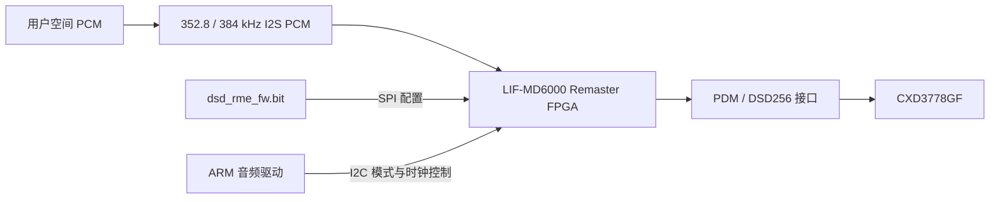

# WM1AM2 1.09 · DSD Remaster 移植研究

截至 2026-10-09，已定位原版硬件数据路径，**尚未取得可移植的完整 PCM→DSD 核心，播放器没有新增 Remaster 开关，也没有完成 ARM→x86 的 Remaster 移植**。按用户最新要求，整机调音研究暂停，本次只检查 DSD Remastering Engine。

Sony 官方确认 WM1AM2 支持将 PCM 转为 11.2 MHz DSD，见[产品说明](https://www.sony.jp/walkman/products/NW-WM1AM2/feature_1.html)。Android 系统并不意味着这一转换在 Android CPU 上完成；下面的判断来自对应版本的原始驱动及设备配置，未把营销描述当作算法实现。

## 已取得的材料

| 材料 | 实际结果 |
| --- | --- |
| 用户提供的 `NW-WM1AM2_0000_V1_09_00_NW_WM_FW.upg` | 1,121,235,472 字节；只读检查，`NWWM` 容器，尚未解密 |
| [Sony 1.09 对应 GPL 包](https://oss.sony.net/Products/Linux/Audio/NW-WM1AM2_20240627.html) | 421,154,627 字节；官方 MD5 校验通过 |
| 完整 GPL 目录 | 143,483 个条目；没有 `.bit`，没有 Sony Verilog／SystemVerilog／VHDL 文件，没有 `icx_nvp.cfg` |
| 原版音频驱动、设备配置、许可 | 50 个常规文件保留原字节及 SHA-256，位于 [research/sony-wm1am2](../research/sony-wm1am2/README.md) |
| 可复现报告 | [证据 JSON](WM1AM2-DSD-REMASTER-EVIDENCE.json)，含 12 个源码定位点及校验结果 |

UPG 的 SHA-256 为 `8d2af31100d5ea5555c9e99eaa313466e013ba41fc5128f3b0ef07aac66620df`。GPL 包 SHA-256 为 `db7ac744eb8e95d2371b55b31f1afb6d4bde07b26061ba29d7e44ea7d654b165`，官方 MD5 为 `43650a7e637d40535422b0b084535d4d`。前者用于固定此次研究的输入文件；尚未解密，所以不能声称其明文校验已通过。

## 原版路径

`imx8mp-icx1298-common.dts` 引用 `imx8mp-dmp1-ndm.dts`，后者引用 `imx8mp-dmp1.dts`。该板级文件包含 `lattice,lifmd6000` 的 SPI 配置设备和地址 `0x41` 的 `sony,lif-md6000-rme` I2C 设备。芯片厂家将 [LIF-MD6000 列为 CrossLink FPGA](https://www.latticesemi.com/en/Products/FPGAandCPLD/CrossLink)。

`imx_aif_pcmdsd_hw_params()` 把 CPU DAI 设为 I2S PCM、codec DAI 设为 PDM，调用 `md6000_setup_params(SND_SOC_DAIFMT_PCM2DSD, rate)`；该路径只接受 352800 或 384000 Hz。RME 驱动设置模式 `0x0e`、PCM 输入、DSD 输出，并通过寄存器使转换器工作。下游 CXD3778GF 的对应分支选择 `DSD 256fs`。

`lif-md6000-rme.c` 通过 `request_firmware()` 读取 `dsd_rme_fw.bit`，再用 `LSC_BITSTREAM_BURST` 命令 `0x7a` 分块经 SPI 写入硬件，每块最多 4096 字节。驱动里没有对 PCM 样本运行完整转换的循环；所取得的 C 代码负责加载、时钟、模式、淡入淡出及静音控制。

因此，可确认官方驱动使用独立 FPGA 的 Remaster 路径。尚未检查加密 UPG 内的用户空间程序，不能据此断言其中绝无其他实现。**把这些寄存器控制函数编译成 Windows C++，不会产生原版 DSD 样本。**

## 解包进展与当前缺口

文件前 128 字节包含 `NWWM`、56 字符的明文 SHA-224 等元数据，其后是加密载荷。既有 Android Walkman 的[解包研究和原始工具代码](https://github.com/97lily/2019_android_walkman)使用 AES-256 CBC、PKCS5／PKCS7 padding；48 个 ASCII 字符的 NAS 参数拆为 32 字节密钥和 16 字节 IV。

已在此文件上检查 NW-A100、NW-ZX500 的两组公开参数和工具中的公开调试参数，均未得到 ZIP 文件头。这是型号参数不匹配，不能据此把用户文件判为损坏。也没有对 AES 密钥空间进行穷举。用户确认没有实机；目前没有匹配 WM1AM2 的 NAS、已解密 vendor 镜像或 `dsd_rme_fw.bit`。

仓库内提供[流式解包工具](../research/sony-wm1am2/scripts/decrypt-nwwm.mjs)：先检查 ZIP 文件头，再验证完整明文 SHA-224；错误参数不生成输出，不覆盖已有目标，不记录 NAS。该工具准备好继续研究的入口，**不代表此 WM1AM2 固件已经解开**。

即使获得 `.bit`，仍需还原完整逻辑、查明是否压缩／加密、取得所有定点位宽、舍入、溢出、反馈状态、滤波系数与初始化条件。FPGA 配置比特并非 ARM 指令；若能恢复完整电路，可进一步构造等价的 x86 C++ 运算，但现在没有足以做到逐位还原的材料。

## 何时才能加入播放器

必须先让同一 PCM 输入通过原电路／可信电路模型和 C++，对比所有 DSD 输出位，并覆盖静音、瞬态、左右声道隔离、连续块状态及不同采样率。通过后才测持续吞吐、首缓冲延迟、多线程及 ASIO／DoP 输出设备兼容性。多线程应保留每个声道的反馈状态，不可任意拆分时间块。

当前没有 Remaster 的真实输出，所以没有 Remaster 频谱或实时通过结论。现有 DSEE AI／DC 相位／Vinyl 的 [336 组逐位对照](SONY-X86-VERIFICATION.json)、[82 组持续实时测试](SONY-REALTIME-VERIFICATION.json)和[真实音乐频谱](SONY-AUDIO-MEASUREMENTS.md)仅验证已有三个效果，不能作为 Remaster 验证。

## 文件许可与保存

原始 GPL 文件保留 Sony／NXP 署名及原许可证，作为研究源码存放，不加入当前播放器 EXE，不改授项目 MIT。NAS、个人曲库、封面缓存及真实音乐处理文件不随研究目录分发。固件目录旁的研究副本包含官方 GPL 原包、已提取材料、校验清单和本说明；未解密的 UPG 保留在用户原来的位置。
